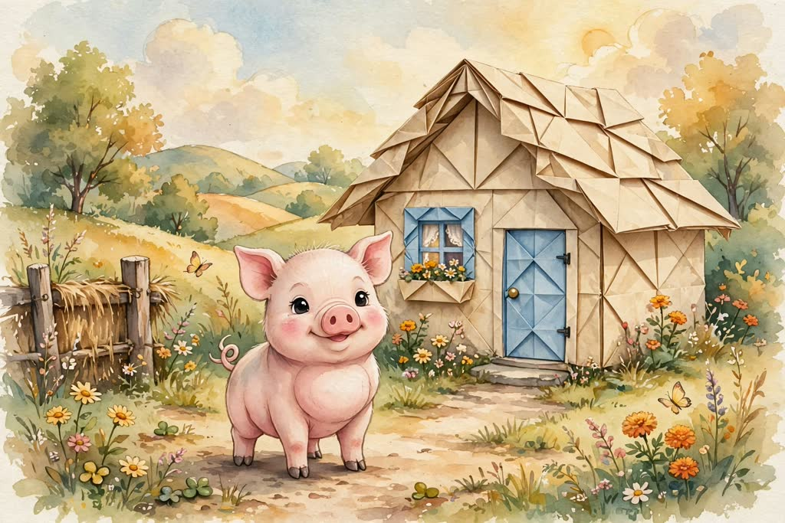

# StoryShaper

> Kids today *watch* stories on endless autoplay. They rarely get to *shape* one.

StoryShaper is an interactive picture book that a child steers with their voice.
The story stops and asks a question, the child answers out loud, and the next page is redrawn to match their idea.

Built for the [Meta Global AI Developer Hackathon](https://cerebralvalley.ai/e/meta-ai-developer-hackathon) (Oct 26 – Nov 4, 2026).
Indie Developer track, theme *Build for Your World*.



## How it works

In *The Three Little Pigs*, the child decides what each pig builds with.

1. The page is read aloud while each word lights up.
2. The story asks: *"What do you think he built his house with?"*
3. The child holds the mic and says *"Paper!"*
4. **Muse Voice Transcribe** turns the answer into text, **Muse Spark** writes the next lines around it, and **Muse Image** redraws the page with a paper house in the same style.
5. The wolf blows, and the child sees why a light house flies away. By the third pig, they reason that it needs something heavy and strong.

Silly answers are not blocked. They are folded back into the story: an ice cream house melts in the sun, so let's try something else.

## Try the prototype

To test **a newly generated picture for each accepted answer**, the microphone and camera together, install `ffmpeg`, copy `.env.example` to `.env`, set `MODEL_API_KEY` locally, and run (Python 3.10+):

```bash
python3 -m vision.server --port 8000
```

Open [the agent playground](http://127.0.0.1:8000/prototype/agent.html) and choose **Live model**. Each accepted typed, spoken or touch answer starts one Muse Image edit and an independent Muse Spark image review. The previous picture stays visible while drawing; only a reviewed result replaces it. Captions distinguish newly generated pictures, prepared offline illustrations and failed generation. You can answer the next question while drawing. Duplicate requests and language changes reuse the same scene generation; failed jobs are not automatically retried. Generated pictures remain in this local server's memory and disappear on restart.

**Speak an answer** records up to eight seconds, transcribes with Muse Voice Transcribe, and puts editable words in the answer box. Press **Continue story** to submit. A first recording or recognition failure immediately opens touch choices. Browser recording needs a secure context: `localhost` works; a tablet opening a plain HTTP LAN address does not.

For a text-only playground without `ffmpeg` or live pictures, use:

```bash
python3 -m story_agent.server
```

Choose **Deterministic mock** to test authored rules without an API key. On the integrated server this mode displays prepared illustrations and makes no story or image model calls. The text-only server can also generate story text with Muse Spark when configured with `MODEL_API_KEY`; its image and microphone services are unavailable.

Use **English / 한국어** at the top to switch the interface, current story, questions and choices. The language is remembered across both prototype screens. Switching preserves story progress and uses authored translations for the current passage; later model responses use the selected language. Earlier test records retain their original wording. Korean reading in the clickable book uses browser speech instead of the existing English recordings.

The agent keeps each question's purpose and permitted story transitions in authored metadata. Its wording follows the chosen material and actual event: a cookie house leads to a question about the wolf eating its walls; a loosely assembled wood house leads to collapse. The first model call interprets the answer and drafts the next passage and question wording. The server determines and validates the transition, identifiers and choices; a second, independent model call reviews the result before it is accepted. Invalid model output leaves story progress unchanged. **The first unaccepted answer or speech failure immediately opens three touch choices.** A short spoken and written invitation guides the child to tap; the cards work before the invitation finishes. Microphone or recognition failures open the already-authored choices locally, without another request. A service failure also offers those choices without counting a child failure. One tap follows server-validated authored story text without a story model call, clearly labeled as a fallback; live picture generation still runs for that accepted answer. The selected option and its original question context are included in `mediaPlan.selection` for image integration.

`python3 -m speech.server` also provides live pictures and microphone input, without the camera. See [the speech setup](speech/README.md) and [media API](media/API.md).

Custom materials retain their server-approved identity in the generated picture request. Generation or review failure uses a matching prepared illustration when available, or keeps the previous picture with an explanatory caption. Image prompts contain approved material, action and character facts; raw failed speech and camera frames do not enter the image request. Live story and transcription send their respective inputs to Meta. Live video generation, physical device validation and production family access controls remain unfinished. Parent-voice narration requires the separate narration service. The local server listens only on `127.0.0.1`; sessions and answers disappear on restart.

```bash
python3 -m unittest discover -s tests -v
```

See [the story-agent design and test guide](docs/internal/story-agent.md) for the API, scenario checks and current limits.

The clickable prototype shows the full story flow with real pages generated by Muse Image.
It is labeled **Fixed story demo** and links directly to the **live AI test**. Changing modes in the agent playground starts a new session with that provider; **Refresh connection** checks server configuration again after a key is added.
In this fixed demo, the microphone and live API calls are not connected: tapping the mic always "hears" the first answer, and **Settings → Show demo answers** (or `?demo=1` in the URL) adds buttons to answer for the child.

```bash
open prototype/index.html        # macOS
start prototype\index.html       # Windows (PowerShell)
```

The UI follows concept A "Open Storybook" from `StoryShaper_UI_Design_3_Concepts.md`:
one shared screen for child and parent, Light / Dark / Auto themes (design tokens at the top of `prototype/style.css`),
and a story state machine (`READING → ASKING → LISTENING → HEARD → GENERATING → UPDATED`, plus `ERROR`) in `prototype/app.js`.

The layout is mobile-first and was checked at 320 × 568 up to 430 × 932 phones, on their side, and at the sizes of a Galaxy Z Fold8 (outer and inner screen) and an iPhone Duo (outer and inner screen):
upright it stacks picture, text and controls; the microphone stays on the right of the control row at every screen size; on a short landscape screen it becomes a two-page spread (picture left, story right).
A half-folded "Flex" posture (picture on the top half, story and mic on the bottom half) and dual-screen devices are handled through the Viewport Segments media queries at the end of `prototype/style.css`.

## Meta models we use

| Model | Role |
|---|---|
| `muse-voice-transcribe-1.0` | Understands the child's spoken answer |
| `muse-spark-1.3` | Interprets the answer and writes the next lines |
| `muse-image-1.0` | Edits the current page to match the child's idea, keeping characters and style |
| `sam-3.1` | (Planned) Cuts a child's own drawing out of a photo to place it in the story |

## Repository

| Path | What's in it |
|---|---|
| `prototype/` | Clickable design prototype (HTML, CSS, JS) and the story pages |
| `experiments/` | Scripts that test each Meta API, measure latency, generate the story pages and narration, and check the story data |
| `docs/internal/` | Team planning notes (Korean) |
| `voice/` | Voice-cloning samples and a blind comparison page (`compare.html`) |

To rerun the experiments, put `MODEL_API_KEY=...` in a `.env` file at the repo root (it is git-ignored).

After editing `prototype/story.js`, check that every scene, picture and narration clip it points to exists:

```bash
node experiments/narration_lines.mjs   # refresh the list of lines to narrate
node experiments/check_story.mjs       # exits with an error if anything is missing
```

## Narration in a parent's voice

The Meta Model API has no text-to-speech, so the story is read aloud by an open-source voice-cloning model.
A parent records about 30 seconds once, and every page is read in their voice.

We blind-tested three models on the same 6.5-second reference clip and the same five story lines (1–5 scores):

| Model | Similarity | Naturalness | License |
|---|---|---|---|
| **Chatterbox** (chosen) | **4.0** | **4.2** | MIT |
| F5-TTS | 3.2 | 2.6 | Weights CC BY-NC |
| Qwen3-TTS 1.7B | 3.2 | 2.4 | Code Apache 2.0 |

Chatterbox also adds an inaudible watermark to every clip it generates, which helps guard against misuse of a cloned voice.

Each character has a voice that fits them. We compared four options by ear: the narrator and the three pigs are read in the parent's voice (the pigs a little livelier), and the wolf has a different stock voice (LibriTTS-R, CC BY 4.0), so a child always knows who is speaking. Changing only the pitch of the parent's voice scored lowest.

**A parent who is away can still read.** On `prototype/voice.html` a parent chooses whose voice it is (their own, a family member who agreed, or someone the family misses), then adds a video or a voice message, or reads a short bedtime passage aloud. StoryShaper finds the clearest ten seconds on a waveform, shows what **Muse Voice Transcribe** heard, plays a story line in that voice, and keeps only that ten-second clip. **Delete** removes the clip and every line read with it.

Lines are generated as the story needs them, newest first, and cached, so a line is made once. If a line isn't ready in time the browser voice reads it and the story keeps going.

```bash
voice/.venv-chatterbox/bin/python -m narration.server   # voices, port 8100 (needs Chatterbox and ffmpeg)
python3 -m speech.server                                 # story agent, media and speech, port 8000
```

Then open `http://127.0.0.1:8000/prototype/voice.html` to add a voice and `agent.html` to hear the story. Details: [`narration/README.md`](narration/README.md).

## Progress

**Done**
- Added a local text-input story-agent playground with material-dependent questions, server-owned transitions, model validation, three-choice recovery, and clearly labeled offline/live modes. Automated tests cover all 50 authored material paths in English and Korean, custom materials, and error handling. Earlier three-call Korean Muse Spark runs passed interpretation, generation and review; live quality and latency evaluation of the new two-call path remains pending.
- Tested every Meta Model API capability we need: text, chat, image generation and editing, image understanding, speech to text (English and Korean), and SAM 3.1.
- Measured one story turn: speech to text ~3 s, next lines ~3–7 s, page redraw 12–20 s. The redraw is the bottleneck, so the design hides it behind narration.
- Built a clickable prototype of the full *Three Little Pigs* story with 13 pages generated by Muse Image, kept consistent by editing each page from the previous one.
- Found that the image content filter rejects some wolf scenes inconsistently; the page generator retries with softer wording.
- Picked Chatterbox for parent-voice narration after a blind test.
- Narrated the prototype in a parent's cloned voice: 40 pre-generated clips, one per line and answer branch, with a reading speed slider.
- Gave each character a voice (parent for the narrator and pigs, a stock voice for the wolf) through a local narration server that the story agent page uses, with a browser-voice fallback.
- Let a parent register a voice from a video, a voice message or a read-aloud passage, with consent, a preview, and deletion of the voice and everything read with it.

**Next**
- [ ] Wire the real pipeline into the web app: microphone → Muse Voice Transcribe → Muse Spark → Muse Image.
- [ ] Put the child's own words into the book as dialogue, with their recorded voice.
- [ ] Safety: guide unexpected or unsafe answers back into the story.
- [ ] Let a child draw themselves, cut the drawing out with SAM 3.1, and place it in the story.
- [ ] Test with a real child and adjust questions and timing.
- [ ] Record the 3-minute demo video and submit by Nov 4, 9:00 PM ET.
