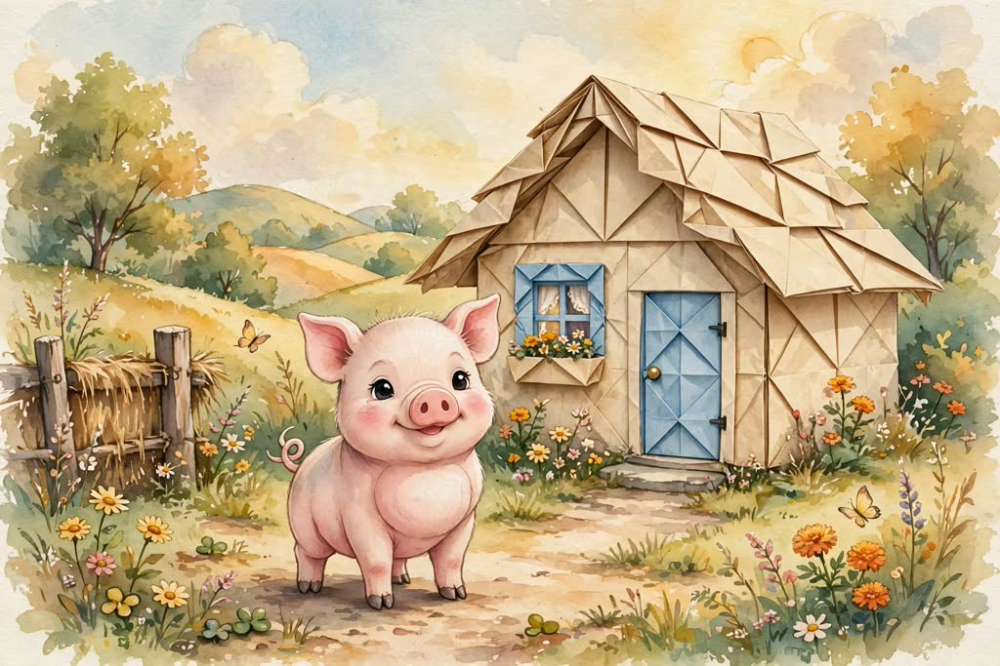

# StoryShaper

> A picture book in your voice. A story your child helps shape.

**[Read the book](https://storyshaper.vercel.app) · [Watch the submitted demo](https://youtu.be/FXtuQ7iy4z0)**

Woojoo can't talk yet. Her dad is on our team. He wants to read her every bedtime story in his own voice, and when she can talk, he wants the story to talk back.

StoryShaper is a picture book that does both. A parent records one short passage, once, and the book is narrated in their voice. Then it stops and asks the child what happens next. She says **“Thin paper!”** and the page is repainted with a thin-paper house. The wolf blows, the paper flutters apart, and the book asks her why.

Children today watch stories on autoplay. Here, they shape one.

Built during the [Meta Global AI Developer Hackathon](https://cerebralvalley.ai/e/meta-ai-developer-hackathon). **Development and submission of the hackathon build are complete.** The submitted experience is *The Three Little Pigs*, with English and Korean reading, parent-voice narration, child-directed illustrations and narration-synced animation.



## Why we built it

- **A parent who is far away can still read every night.** The child hears a familiar voice, even when the parent cannot be there.
- **The child takes a turn.** Choosing a material, predicting what will happen and explaining why make the child an active participant in the story.
- **A parent's voice can cross a language barrier.** The same reference recording can narrate English and Korean. In our demo, an English recording reads the book in Korean.

The book keeps its characters, main events and safe ending. The child changes the materials and reasons about their consequences: a paper house blows apart; a cookie house invites a different explanation. When an idea goes too far—“The wolf eats the pigs!”—the book gives a gentle reason and three pictures to tap.

## What one answer goes through

Our toughest users say their prompts out loud and expect the next page to understand them. Each model has a concrete job:

| Model | Role in StoryShaper |
| --- | --- |
| **Muse Voice Transcribe** (`muse-voice-transcribe-1.0`) | Transcribes English/Korean answers. Voice registration also supports consent and reference-clip transcription when the narration service has a Meta API key. |
| **Muse Spark 1.3** (`muse-spark-1.3`) | Interprets answers, writes dialogue/questions, reviews text when needed, recognizes camera objects and independently reviews every newly generated illustration. |
| **Muse Image 1.0** (`muse-image-1.0`) | Edits a reference page to reflect the child's material while preserving the pigs and watercolor style. |
| **SAM 3.1** (`sam-3.1`) | Located the wolf, pigs and houses in prepared illustrations; saved object regions guide narration-synced effects. |

1. **Listen.** The browser records an answer; the server converts it with `ffmpeg` and sends it to Muse Voice Transcribe. The child can also show an object to the camera, type an answer, or use touch choices.
2. **Understand and write.** One low-reasoning Spark call interprets the answer and drafts the next lines and question. The server owns story state and validates fixed events, material rules and safety constraints. The default adaptive pipeline adds a second Spark review for unfamiliar materials, complex answers and other turns needing review.
3. **Repaint.** An accepted free answer starts an Image edit using approved story facts. Authored touch choices reuse a matching saved illustration when one exists.
4. **Review before showing.** A separate Spark call checks safety, material, characters, action and expression. Rejected generated pictures are never displayed. The next answer stays locked until an approved picture or reviewed scene backup is on screen.
5. **Read and animate.** Chatterbox narrates in the selected voice. Browser effects follow line and scene cues for the wolf's breath, fluttering paper and the house's reaction. Prepared pictures use SAM-derived regions; new generated pictures use default effect regions.

Editing is what makes an unplanned page still feel like the same book. A new material changes the house while keeping the characters and style. Spark's review passes let the story welcome a cookie house while steering unsafe ideas toward its authored boundaries.

SAM processing happens ahead of time on the prepared artwork. The shipped motion uses browser animation and saved object regions, rather than a video-generation request for every turn.

## A parent's voice, in English and Korean

Open **Add a parent's voice** from the reader. Record a short passage or upload an audio/video recording, choose a clear ten-second reference, preview a story line and save. The flow records permission and offers deletion. Where Muse transcription is configured on the narration service, it also checks the spoken permission sentence and shows what was heard in the reference clip.

After saving, only the reference clip and profile remain; the full upload is removed. Deleting a voice removes its reference and generated narration cache. Hosted profiles require the access key issued to the creating browser.

The parent voices the **narrator**. Each pig and the wolf has a distinct stock voice, with delivery controls derived from the script's personality, tone and emotion. English uses Chatterbox; Korean uses Chatterbox Multilingual with the same parent reference.

The reader starts when the first sentence is ready, then prepares later sentences during playback. Fixed storybook-voice lines ship in the app's audio pack; new wording and parent-voice lines are synthesized and cached by the voice service. Upcoming authored choices are prepared ahead of time.

During development, moving **six-line parent-voice scene synthesis from a Mac to a Modal L4 GPU reduced 67–106 seconds to 23–27 seconds**. These are whole-scene synthesis measurements, not the current time to first audio. Cold starts after idle time and container restarts on deploy were the main friction. See the [voice worklog](docs/internal/voice-worklog-2026-10-31.md) for measurements and playback changes.

## Reading and recovery

- **AI version:** live interpretation, speech transcription, camera recognition and image editing. Nine participation points cover choosing, predicting and explaining across the three houses.
- **Offline version:** authored branches, prepared pictures and touch choices without a Meta API key. Fixed storybook narration is bundled with the app.
- **Gentle recovery:** the first unaccepted answer or recording/recognition failure opens three active touch choices. Service errors offer choices without treating them as the child's mistake.
- **Bounded image recovery:** a failed generation is retried once. After two failures, a pre-reviewed, material-independent scene backup lets reading continue. An unreviewed generated picture is never used as the fallback.
- **Page controls:** go back, replay, pause, change speed or answer an earlier question again. A new answer replaces the later branch. Manual next-page navigation uses a server-authored safe choice and a prepared backup without generating an image.
- **Reader settings:** English/한국어, built-in or saved narrator voices, light/dark appearance and an installable web-app manifest.

Text and narration can begin while the next picture is being prepared. The previous picture stays visible with a drawing indicator; answer input opens after the new picture is displayed.

## Run locally

The integrated app needs **Python 3.10+** and **`ffmpeg` on your PATH**. From the repository root:

```bash
cp .env.example .env
# For AI version, set MODEL_API_KEY in .env using your own Meta Model API key.
python3 -m src.server
```

Open [http://127.0.0.1:8000/](http://127.0.0.1:8000/). Choose **Offline version** to read without an API key, or **AI version** for live models. Keep API keys on the server. Microphone and camera access require localhost or HTTPS.

Run one app server at a time. If port 8000 is occupied, use the existing server or stop it in its terminal before restarting.

| Setting in `.env.example` | Default / purpose |
| --- | --- |
| `MODEL_API_KEY` | Your Meta Model API key for live story, image, speech and camera requests. |
| `STORY_AGENT_MODEL` | `muse-spark-1.3` |
| `STORY_AGENT_PIPELINE` | `adaptive`; `two_call` enables independent text review on every generated turn. |
| `STORY_AGENT_COMPOSE_EFFORT` / `STORY_AGENT_REVIEW_EFFORT` | `low` |
| `STORY_IMAGE_REASONING_STRENGTH` | `low`; generated images still receive independent review. |

### Optional local parent-voice service

The reader defaults to the hosted Modal voice service, including when the app runs locally. To synthesize on your own machine, create the separate Chatterbox environment with Python 3.11:

```bash
python3.11 -m venv voice/.venv-chatterbox
voice/.venv-chatterbox/bin/pip install -r narration/requirements.txt
python3 -m src.server
```

When that environment exists, the app starts narration on port 8100. Open [the reader with local narration](http://127.0.0.1:8000/?voiceServer=http://127.0.0.1:8100) to select it; the address is remembered. Model weights download on first use. The narration service also needs `MODEL_API_KEY` for Muse-backed consent/reference transcription.

See [narration setup and APIs](narration/README.md), [speech input](speech/README.md) and [camera input](vision/README.md) for component details.

## Deployment

| Component | Hosting and responsibility |
| --- | --- |
| Web reader | Vercel serves `prototype/` and forwards `/api/*` to the story service through [`vercel.json`](vercel.json). |
| Story service | A Modal CPU container runs the integrated server: story state, Meta calls, pictures, speech and camera. Sessions persist on a Volume. See [`deploy/modal_story.py`](deploy/modal_story.py). |
| Voice service | A separate Modal GPU container runs Chatterbox, preferring L4 with A10G/T4 alternatives. Profiles, generated clips and models persist on a Volume. See [`deploy/modal_voice.py`](deploy/modal_voice.py). |

Both services scale down after idle time and use per-second billing. The submitted product is a hosted web app; the repository also preserves development tools, model comparisons and image-to-video experiments.

## Repository and verification

| Path | Contents |
| --- | --- |
| [`prototype/`](prototype/) | Reader, narration playback, input controls, motion effects, PWA files and prepared artwork/audio. |
| [`story_agent/`](story_agent/) | English/Korean story data, character scripts, material rules, state transitions and Spark generation/review. |
| [`media/`](media/) | Image editing/review, asset selection, generation jobs, backups and SAM region preparation. |
| [`speech/`](speech/) / [`vision/`](vision/) | Transcription, object recognition and integrated HTTP routes. |
| [`narration/`](narration/) | Voice registration, character casting, Chatterbox synthesis, caching and recording tools. |
| [`src/server.py`](src/server.py) | Single local app entry point. |
| [`deploy/`](deploy/) | Modal story and voice deployments. |
| [`tests/`](tests/) | Python and Node regression tests. |
| [`experiments/`](experiments/) | Model probes, asset generation, narration comparisons and story checks. |
| [`docs/internal/`](docs/internal/) | Planning history, detailed designs, benchmarks and worklogs, mainly in Korean. |

Run automated checks without live model requests. Use a Python environment with `numpy` installed; the Chatterbox environment already includes it:

```bash
python3 -m unittest discover -s tests -v
# With the optional Chatterbox environment instead:
# voice/.venv-chatterbox/bin/python -m unittest discover -s tests -v
node --test tests/*.test.cjs
node experiments/check_story.mjs
```

Node tests use the built-in test runner. The suites cover both languages, material paths, safety/state validation, input recovery, image review/backups, branch navigation, voice handling and motion cues. `check_story.mjs` checks the earlier fixed-book fixtures and their assets.

Provider and browser mocks verify behavior under controlled responses; they do not measure live model quality or children's learning outcomes. The submitted demo shows the live product experience.

## Team and acknowledgments

| Team member | Contribution |
| --- | --- |
| 현준 | Parent and character voices, narration and voice infrastructure. |
| 지호 | Story agent, material reasoning, dialogue/questions and guardrails. |
| 수찬 | Reader UI/UX, app experience and image/motion integration. |
| 형서 | Demo video and submission storytelling. |

Meta's models handle understanding, story generation, image editing, visual review and prepared-art segmentation. Voice output uses [Chatterbox](https://github.com/resemble-ai/chatterbox). Stock character reference clips come from LibriTTS-R; source details and CC BY 4.0 attribution are in [`voice/characters/SOURCES.md`](voice/characters/SOURCES.md).

Prepared scene backups include generation prompts, source images and independent review records in [`prototype/img/fallback/`](prototype/img/fallback/). The [story script guide](story_agent/README.md) and [narration design](docs/internal/narration-design.md) document shared character and delivery metadata.
