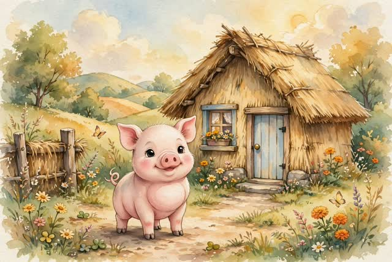
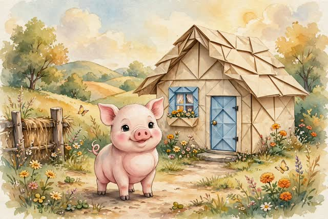

# Meta Model API 기능 테스트

2026-10-27, `experiments/api_smoke_test.py`로 각 기능을 한 번씩 호출한 결과입니다.
시간은 한국에서 호출한 1회 측정값이라 참고용입니다.

## 요약

| # | 기능 | 모델 | 결과 | 시간 |
|---|---|---|---|---|
| 1 | 모델 목록 | - | ✅ | 0.7s |
| 2 | 텍스트 생성 (Responses) | muse-spark-1.3 | ✅ | 6.8s |
| 3 | 추론 모델 | muse-wonder-1.0 | ❌ `model_not_found` | - |
| 4 | Chat Completions (OpenAI 호환) | muse-spark-1.3 | ✅ | 5.6s |
| 5 | 이미지 생성 | muse-image-1.0 | ✅ | 14.2s |
| 6 | **이미지 수정 (짚집 → 종이집)** | muse-image-1.0 | ✅ | **16.9s** |
| 7 | 이미지 이해 | muse-spark-1.3 | ✅ | 4.7s |
| 8 | 음성 인식 (한국어) | muse-voice-transcribe-1.0 | ✅ | 3.0s |
| 9 | 세그멘테이션 | sam-3.1 | ✅ | 2.6s |

## 우리 프로젝트에 주는 의미

- **핵심 기능(그림 바꾸기)은 된다.** 이미지 수정이 구도, 화풍, 캐릭터를 그대로 두고 집만 종이집으로 바꿨다.
- **한국어 음성 인식이 된다.** 언어 설정 없이 한국어를 알아들었다.
- **속도가 가장 큰 과제다.** 아이 답 → 인식(3초) → 다음 장면 글(6~7초) → 그림 수정(17초)을 순서대로 하면 한 턴에 25초가 넘는다.
  - 아이디어: 글과 음성을 먼저 보여주고 그림은 뒤이어 바꾸기, 인식과 글 생성을 병렬로, 이미지 스트리밍 응답(`text/event-stream`, 아직 미테스트) 활용.
- **TTS(음성 출력) 모델은 없다.** 모델 목록에도 없고, 문서에도 Muse Voice Transcribe는 "음성을 합성하지 않는다"고 되어 있다. 읽어주기는 다른 방법이 필요하다.
- **Muse Wonder는 아직 못 쓴다.** 내 키의 모델 목록에 없다. preview라 별도 접근 권한이 필요한 것으로 보인다.

## 상세

### 2. 텍스트 생성 (muse-spark-1.3)
프롬프트: 아이가 "첫째 돼지 집은 종이로 만들었어"라고 답했을 때 다음 장면을 5살 눈높이로 3문장.

> 우와, 첫째 아기돼지가 종이로 집을 슥삭슥삭 만들었어! 종이집은 가볍고 예뻐서 첫째 돼지가 방긋방긋 웃었어. 그런데 저기서 늑대가 후우 불면 어떻게 될까?

아이 답을 반영하고, 다음 질문으로 자연스럽게 이어간다.

### 4. Chat Completions
`POST /v1/chat/completions`가 OpenAI 형식 그대로 동작한다. 기존 OpenAI SDK 코드를 `base_url`만 바꿔서 쓸 수 있다.

### 5–6. 이미지 생성과 수정 (muse-image-1.0)

| 생성: 짚집 | 수정: 종이집 |
|---|---|
|  |  |

- 응답은 `data[0].b64_json`, 형식은 **webp**, 크기는 1920×1280.
- 수정은 JSON 본문의 `images: [{"image_url": "data:image/webp;base64,..."}]`로 원본을 넘긴다.
- 프롬프트: "change the straw house into a house made of paper and folded origami, keep the pig, style and composition the same"

### 7. 이미지 이해
`input_image`에 base64 data URL을 넣으면 된다.

> 분홍색 통통 아기 돼지가 짚으로 만든 포근한 집 앞에서 예쁜 꽃들이랑 나비들이랑 함께 방긋방긋 웃고 있어요.

### 8. 음성 인식 (muse-voice-transcribe-1.0)
Mac 음성(유나)으로 "종이로 만들었어요! 바람이 불면 날아갈 것 같아요."를 녹음해서 테스트했다.

```json
{"transcript": "종이로 만들었어요. 바람이 불면 날아갈 날아갈 것 같아요.", "audioDurationMs": 3680}
```

- 16kHz 모노 WAV, `mode: PUSH_TO_TALK`.
- "날아갈"이 한 번 중복됐다. 실제 아이 목소리로 다시 확인이 필요하다.

### 9. SAM 3.1
텍스트 프롬프트 "pig"로 돼지를 찾았다.

```
<0f>0<|box;x1=515;y1=567;x2=959;y2=1169;w=1920;h=1280|><|mask;x=0;y=0;data=...|>
```

박스가 그림 속 돼지 위치와 맞는다. 마스크 해석에는 `meta-sam-parser`(Python) 라이브러리를 쓴다.

## 다시 돌리기

```bash
echo 'MODEL_API_KEY=...' > .env     # git에 올라가지 않음
python3 experiments/api_smoke_test.py
```

결과물은 `experiments/out/`에 저장된다 (git 제외). 이미지 생성과 수정은 크레딧이 든다.
