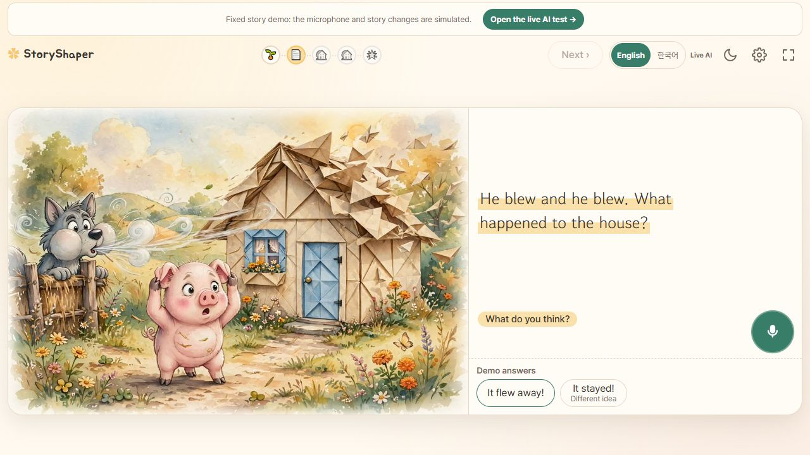

# 이미지·영상 기반 및 독서 UI 통합 구현 보고서

작성: 2026-10-29 KST. PR 대상: `main`.

## 요약

동화 에이전트가 확정한 `mediaPlan`을 받아 장면에 맞는 기존 이미지를 선택하고, 비동기 로컬 영상 작업을 생성·조회·취소하는 기반을 구현했다. 취소된 작업이 새 세션에서도 취소 상태로 재사용되던 오류를 수정했다. 독서 화면에서는 마이크를 조작 영역 오른쪽으로 통일하고, 이미지 전환을 디코딩 완료 후 시작하는 짧은 크로스페이드로 변경했다.

`img2vid`와 `ui_mvp`를 통합 브랜치에 병합했으며 충돌은 없었다. 실제 생성형 영상, UI와 미디어 API의 플레이어 연결, Z Fold8 실기기 검증은 완료 범위에 포함하지 않는다.

## 통합한 작업

| 구분 | 포함한 커밋 | 구현 내용 |
| --- | --- | --- |
| 기준 `main` | `18f92d5` | 기존 동화 에이전트·한영 전환·독서 프로토타입 |
| `img2vid` | `8da48d9` | Meta 키 없이 기존 이미지로 영상 요청 JSON 준비 |
| `img2vid` | `890caa8` | MediaSpec·장면 자산·로컬 작업 관리·HTTP API |
| `img2vid` | `2934c07` | 취소된 콘텐츠의 새 요청 복구 및 회귀 테스트 |
| `ui_mvp` | `b193c6a` | 화면 크기별 마이크 위치 통일 |
| 통합 후 추가 | 이 PR의 이미지 전환 변경 | 디코딩 대기·레이어 교체·실패 대체·움직임 줄이기 |

통합 브랜치는 `codex/integrate-media-ui`다. 이번 사용자 요청에 따라 두 작업을 하나의 `main` 대상 PR로 묶었다. 각 작업 브랜치의 기존 커밋 이력은 보존했다.

## 1. 동화 에이전트와 미디어의 경계

현재 `main`의 동화 에이전트가 아이 답의 적합성·재료·사건을 결정한다. 미디어 계층은 답을 다시 해석하거나 새로운 사건을 만들지 않는다.

```text
아이 답 → 동화 에이전트의 검증·상태 확정 → mediaPlan
                                            ↓
                             MediaSpec 검사·장면 자산 선택
                                            ↓
                             비동기 로컬 작업·조회·취소
                                            ↓
                           이미지 / 검수된 클립 / 대체 상태
```

마지막 결과를 독서 화면에 재생하는 연결은 후속 UI 작업이다. 기존 에이전트 시험 화면은 미디어 계획을 JSON으로 보여주며, 이 PR이 플레이어 연동 완료를 의미하지 않는다.

### 전달 규격 검사

구현: [`media/contracts.py`](../../media/contracts.py).

- 서버 세션의 확정된 snapshot에서 MediaSpec을 만든다. 클라이언트가 보낸 mediaPlan·자산 URL은 받지 않는다.
- 세션·장면·버전·언어·허용 재료·집·사건·배역·안전 상태가 서로 맞는지 검사한다.
- `accept/complete`의 검증된 계획만 처리한다. `clarify/redirect/service_error` 등 새 계획이 없는 응답은 작업을 생성하지 않는다.
- 검증된 객관식 선택지의 `authoredFallback=true`는 정상적으로 처리한다.

### 장면 시점과 자산 선택

구현: [`media/assets.py`](../../media/assets.py), [`scene_registry.json`](../../media/scene_registry.json).

| 현재 동작 | 표시할 장면 | 주의점 |
| --- | --- | --- |
| `build` | 완성된 집의 정지 이미지 | outcome에 미래의 붕괴 결과가 있어도 사건 영상을 먼저 보여주지 않음 |
| `blown_away/collapsed/eaten/melted/stood` | 확정된 실제 사건 | 과자·아이스크림을 바람 장면으로 치환하지 않음 |
| `move_to_next_house` | 다음 집의 빈 터 | sceneId의 목적지와 houseId의 출발 집을 구분 |
| `safe_ending` | 함께 안전하게 있는 결말 | 임의의 새 사건을 만들지 않음 |

등록한 그림은 첫 집 종이·짚, 둘째 집 나무, 마지막 집 벽돌과 각 빈 터·결말이다. 집과 재료 조합에 맞는 그림이 없으면 명시적으로 대체 상태를 반환한다. 다른 돼지나 재료의 그림을 생성 성공으로 표시하지 않는다.

## 2. 비동기 작업과 HTTP API

구현: [`media/jobs.py`](../../media/jobs.py), [`media/server.py`](../../media/server.py).

기존 동화 엔진·서버 파일을 직접 수정하지 않고 확장 서버로 연결했다.

```powershell
python -m media.server --port 8000
```

이 CLI는 `.env`를 읽지 않고 외부 API를 호출하지 않는다. 기존 mock 동화와 미디어 API를 같은 localhost 서버에서 시험한다.

| 기능 | 요청 |
| --- | --- |
| 작업 생성 | `POST /api/media/jobs` — `{sessionId, sceneId, version}` |
| 상태 조회 | `GET /api/media/jobs/<jobId>?sessionId=<sessionId>` |
| 작업 취소 | `POST /api/media/cancel` — `{sessionId, jobId}` |

- 동일 세션·장면·버전 요청은 동일 jobId를 반환한다.
- 공개 로컬 콘텐츠는 언어만 바뀌면 진행 중 작업 또는 완료 결과를 재사용한다.
- 상태는 queued/running/ready/fallback/failed/cancelled다. 등록·검수된 로컬 MP4가 있을 때만 ready와 video를 반환한다.
- 현재 clips 레지스트리는 비어 있다. 기본 실행은 영상 생성 성공이 아니라 기존 이미지와 영상 대체 상태를 반환한다.
- 장면 변경·취소·제한시간 이후 늦게 도착한 결과는 이전 화면에 적용되지 않는다. 영상 실패는 동화 에이전트의 아이 응답 실패 횟수에 포함하지 않는다.
- 다른 세션 작업 조회, 검수되지 않은 클립, 등록 경로 밖 파일을 차단한다. 기존 localhost Host/Origin 제한을 재사용한다.
- 작업자 2개, 작업 바인딩 최대 256개, 기본 제한시간 15초다. 모두 메모리 기반이며 서버 재시작 시 소멸한다. 운영 계정·가족 권한·영속 저장의 완료를 뜻하지 않는다.

상세 계약과 UI 연결 순서: [`media/API.md`](../../media/API.md).

## 3. 취소 후 새 요청 복구 오류 수정

### 재현된 문제

진행 중인 종이집 작업을 취소한 뒤 새 세션에서 같은 장면을 요청하면, 콘텐츠 키가 같다는 이유로 이전 작업의 cancelled 상태를 재사용했다. 새 작업도 `apply=false`, `image=null`을 반환해 정상 이미지까지 표시하지 못했다. 취소 후 언어를 바꿔 새 version을 요청하는 경우도 같은 문제가 있었다.

### 수정 내용

- 같은 요청의 취소·중복 방지 기록은 유지한다.
- 새로운 세션 또는 version 요청은 취소된 콘텐츠 작업을 새 로컬 작업으로 대체할 수 있다.
- 각 바인딩·실행·타이머가 정확한 작업 인스턴스를 참조하도록 분리했다.
- 이전 작업의 늦은 완료, 타이머, 반복 취소가 새 작업을 변경하지 못하게 했다.
- 다른 세션이 사용 중인 공유 콘텐츠를 한 세션의 취소로 중단하지 않는 기존 동작은 유지한다.

수정 전 두 신규 재현 테스트가 실제로 실패했으며, 수정 후 새 세션·새 version·이전 콜백·HTTP 통합 경로를 포함한 회귀 테스트를 통과했다. 수정 전 실패 로그도 보존했다.

## 4. 마이크 위치 일관성

구현: [`prototype/style.css`](../../prototype/style.css).

좁은 화면에서는 왼쪽, 넓은 화면에서는 오른쪽에 있던 마이크를 본문 아래 조작 영역 오른쪽으로 통일했다. 상태 안내와 다시 말하기는 왼쪽에 둔다. 그림·본문의 반응형 배치와 기기별 마이크 크기는 유지한다.

사용자가 예상한 우선 기기는 Z Fold8이다. 실제 접은 화면·펼친 화면·회전·터치 검증은 후속 항목이다.

## 5. 이미지 전환 개선

구현: [`prototype/image-transitions.js`](../../prototype/image-transitions.js), [`prototype/app.js`](../../prototype/app.js), [`prototype/style.css`](../../prototype/style.css).

기존 프로토타입은 정적 JPG를 교체한다. 일반 페이지는 페이드, 집 생성은 1.6초의 좌우 와이프를 사용했고, 새 그림이 실제로 디코딩됐는지 확인하지 않은 채 효과와 고정 시간 뒤의 src 교체를 실행했다.

변경한 동작:

- 일반 페이지와 집 생성 모두 420ms 크로스페이드를 사용한다.
- 새 이미지 로딩·디코딩이 끝날 때까지 기존 그림을 유지한다.
- 전환 완료 시 보이는 이미지의 src를 다시 지정하지 않고 두 이미지 레이어의 역할을 교체한다.
- 집 생성은 모의 생성 대기, 낭독 완료, 이미지 준비가 모두 충족된 뒤 공개한다.
- 빠른 페이지 이동·언어 변경·재시작·화면 이탈 후 오래된 로딩·완료 콜백을 적용하지 않는다.
- 이미지 실패·디코딩 실패·8초 로딩 제한시간에는 이전 그림과 한영 안내를 사용한다.
- 움직임 줄이기 설정에서는 애니메이션 지연 없이 전환한다.

전환 컨트롤러와 동화 흐름 테스트 7개를 추가했다. 실제 GIF 또는 영상 재생 구현은 이번 이미지 전환 수정과 별개다.

## 6. 검증 결과와 근거

| 검증 | 결과 | 실제 실행 시간 |
| --- | --- | --- |
| 통합 브랜치 Python 전체 | 81개 통과, 실패 0 | 4.992초 |
| 이미지 전환 포함 Node UI 전체 | 35개 통과, 실패 0 | 117.3444ms |
| 취소 오류 수정 전 집중 재현 | 25개 중 2개 실패 | 실패 근거로 보존 |

총 116개 테스트가 통과했다. Python 81개 중 미디어 테스트는 27개이며, Node 35개에는 기존 28개와 새 이미지 전환 7개가 포함된다. 재료 조합의 subtest는 별도 독립 테스트 수로 중복 합산하지 않았다. 위 시간은 해당 테스트 실행 시간이며 영상 생성 지연이나 UI 프레임률을 뜻하지 않는다.

재현 명령:

```powershell
python -m unittest discover -s tests -v
node --test tests/book-ui.test.cjs tests/agent-ui.test.cjs tests/image-transitions.test.cjs
```

원본 근거:

- [통합 Python 로그](evidence/2026-10-29-media-ui/python.log)
- [이미지 전환 포함 UI 로그](evidence/2026-10-29-media-ui/ui.log)
- [취소 수정 전 실패 로그](evidence/2026-10-29-media-ui/cancel-before.log)
- [취소 수정 후 전체 로그](evidence/2026-10-29-media-ui/cancel-after.log)
- [실행 환경·소스 해시](evidence/2026-10-29-media-ui/metadata.json)

브라우저 1280×720에서 동화 시작 → 종이집 선택 → 완성 후 늑대 장면 진행을 확인했다. 스크린샷은 완료 상태 근거이며 전환 프레임률 측정은 아니다.



[한국어 HTML 검증 보고서](evidence/2026-10-29-media-ui/report.html)도 함께 제공한다. Node 테스트는 모의 DOM 기반이므로 실제 폴더블 기기의 렌더링·터치·프레임률을 증명하지 않는다. 외부 생성 API 호출은 0회다. 여러 AI 후보를 탐색하는 캠페인으로 확대하지 않았다.

## 7. 남은 작업

1. 독서 UI를 실제 동화 에이전트와 미디어 생성·조회·취소 API에 연결하고 현재 session/scene/version이 맞을 때만 재생한다.
2. 별도 제공사 키·예산이 준비되면 대표 종이집 영상부터 실제 생성하고 캐릭터·재료·사건의 일관성을 검수한다.
3. Meta 이미지 편집을 연결해 기존 그림이 없는 과자·아이스크림·돌 등 분기를 표현한다.
4. 외부 유료 제출 전에 영속 task ID·제출 여부 불명확 상태·과금 중복 방지를 별도로 구현한다.
5. Z Fold8에서 접음/펼침/회전·낭독·녹음 시작 시 중단·이미지/영상 전환을 실제 검증한다.

이번 PR은 로컬 미디어 기반과 독서 UI 개선의 통합이다. 실제 생성형 영상·부모 음성·마이크·미디어 플레이어를 연결한 전체 앱 완주를 완료로 보고하지 않는다.
