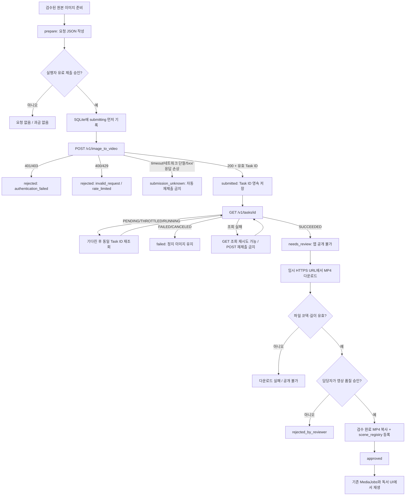

# Runway API: 인증 성공·실패 플로우

> **상태:** 실제 유료 생성은 수행하지 않았습니다. 아래 인증 성공은 Mock 서버에서 시뮬레이션합니다. `1q2w3e4r`는 가짜 테스트 키이며 저장소에 기록하지 않습니다.



## 현재 구현 범위
- `media/runway_api.py`: 인증, 1회 제출, task 폴링, SQLite 중복 과금 방지, 출력 다운로드, ffprobe 검사.
- `media/runway_approval.py`: 사람 검수 후에만 해당 장면의 `clips`에 등록. 이 명령에 --approve라는 명시적 행위가 필요합니다.
- `media/runway_poc.py`: prepare/submit/poll/status/download/approve/reject CLI.
- **의도적으로 미구현:** 자동 유료 생성, 모든 장면 자동 생성, 웹 UI에서 Runway 생성 버튼, 원격 유료 API 성공 증거. 기존 MediaJobs는 검수된 로컬 클립만 반환하며 그대로 유지합니다.
- 운영 수준 동시 다중 리뷰어의 레지스트리 경합/비정상 종료 복구/작업 승인 권한은 별도 강화가 필요합니다.

## 수동 시험
```bash
python -m media.runway_poc prepare --out .tmp/runway-paper
export RUNWAYML_API_SECRET='<real-secret-in-shell>'
python -m media.runway_poc submit --request .tmp/runway-paper/request.json --run-id paper-test-001 --confirm-paid-submit
python -m media.runway_poc poll --run-id paper-test-001
python -m media.runway_poc download --run-id paper-test-001 --out .tmp/runway-paper/output.mp4
# 결과를 실제로 눈으로 검수한 다음에만 실행:
python -m media.runway_poc approve --run-id paper-test-001 --scene-key house1/paper/blown_away
```

작업 저장소는 `.tmp/runway-tasks.sqlite3`이며 Git에 올리면 안 됩니다. 내려받은 영상도 `.tmp/`에 먼저 저장하세요. API 키는 코드·커밋·로그에 포함시키지 않습니다.

Runway 공식 API: https://docs.dev.runwayml.com/api/
