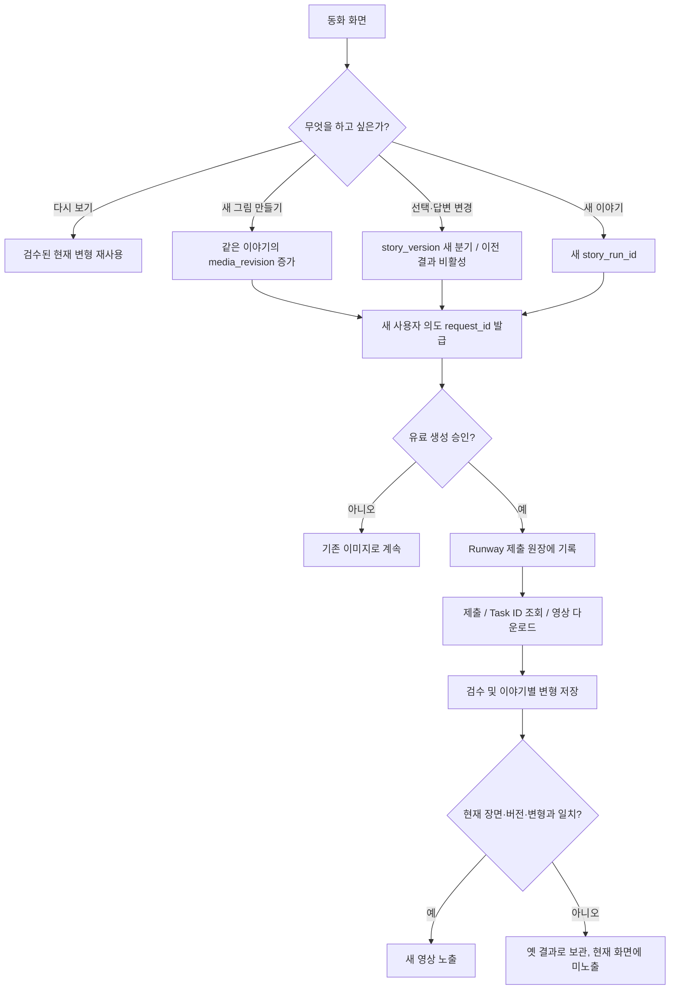

# 이미지·영상 버전 및 새 이야기 분기 정책

## 왜 모든 결과물을 영구 저장하지 않는가?
동화 본문, 사용자가 고른 재료, 아이의 아이디어, 이미지 편집 버전은 계속 변할 수 있습니다. 과금 중복 방지에 필요한 Runway 제출 원장과 동화 이미지의 사용 수명은 서로 다릅니다. **영속성은 재시작 후에도 기록을 유지한다는 뜻이지 모든 MP4를 영구 보존한다는 뜻이 아닙니다.**

## 사용자 의도 별 분기

| 행동 | story_run_id | story_version | media_revision | 재생성 유료 제출 |
|---|---|---|---|---|
| 동일 화면 다시 보기 | 유지 | 유지 | 기존 버전 재사용 | 아니오 |
| 요청 전송이 실패하여 HTTP 재시도 | 유지 | 유지 | 같은 request_id 재사용 | 아니오 |
| 사용자가 '다른 그림으로 다시 만들기' | 유지 | 유지 | +1 | 새 요청, 명시적 비용 확인 |
| 같은 이야기에서 이전 답변 변경 | 유지 | 새 분기 버전 | 해당 장면부터 신규 변형 | 필요 시 새 생성 |
| 완전히 새 이야기 시작 | **새 ID** | 초기화 | 새 이야기 범위에서 시작 | 요청하면 새 생성 |
| 사용자가 옛 그림 선택 | 유지 | 동일한 이야기 버전 | 이전 검수 버전 선택 | 아니오 |

### 책임 경계
- `media/runway_api.py`의 `TaskLedger`: 과금된 제출·Task ID·제출 상태를 기록하며, 같은 `run_id`를 재전송하지 않습니다. 보존 기간과 회계/감사 정책은 별도 합의가 필요합니다.
- `media/variation_store.py`의 `VariationStore`: 이야기 실행별 이미지·영상 변형, 재사용/재생성 의도, 최신 선택을 관리합니다. 기본 story TTL은 **7일(설계 기본값)** 입니다. 이는 **조회/선택 만료**만 적용하며 파일 자동 삭제를 구현한 것은 아닙니다.
- `scene_registry.json`: 팀이 검수한 **공통 기본 동화 자산만** 유지합니다. 아이별 생성물을 공유 레지스트리에 추가하면 다른 이야기에도 새어 나갈 수 있으므로 금지합니다.
- `media/runway_approval.py`: 기존 공통 장면 수동 승인 POC로 남기고, 개인화된 결과는 `VariationStore.review`로 분리합니다.
- `story_agent`의 이야기 분기 확정은 지호님 담당입니다. UI가 이야기 상태를 임의로 수정하지 않습니다.

### 다음 통합에서 반드시 할 것
1. 지호님 확정 스냅샷과 변형 요청에 서버 측 소유권·세션 검증을 붙입니다. 새 이야기 요청과 재생성은 별도 승인 액션으로 만듭니다.
2. `VariationStore.request`가 반환하는 `variant.id`를 Runway `submit_once`의 `run_id`로 사용합니다. 유료 호출에 앞서 사용자에게 비용을 고지하고 확인합니다.
3. 개인화된 영상 파일은 인증된 요청으로만 제공하며, 공개 `prototype/video/`에 넣지 않습니다. 현재 변형 스토어 자체는 API 노출/사용자 인증을 구현하지 않았습니다.
4. 만료된 개인화 파일의 삭제와 보존기간 연장·내보내기는 저장소 정책과 보호자 동의에 따라 별도 구현합니다. 파일 삭제 전 감사 기록을 유지해야 하는 범위를 검토합니다.
5. 동시 요청 경합·스토리 분기·구 결과 콜백·서버 재시작 복구와 영상 리뷰를 E2E로 테스트합니다.

실제 Runway 영상 생성은 아직 테스트하지 않았습니다.
